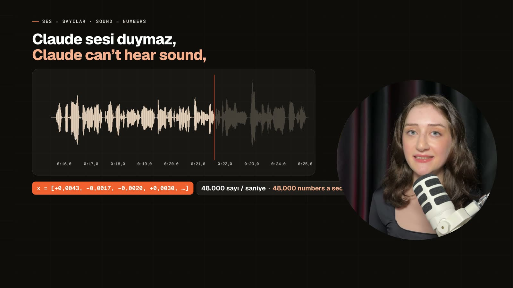

# Antigravity Video Editor

A high-performance video editing pipeline and interactive web studio designed for Antigravity. Create polished talking-head, tutorial, explainer, TikTok, Instagram Reels, and YouTube Shorts videos: word-accurate cuts from raw footage, automatic EDL generation, 3-word dynamic subtitles, segment speed control, Canva/CapCut-style browser studio with two-way sync via `edits.json`, mathematical sound effects, and frame-exact headless Chrome rendering.



> **Antigravity makes precise, automated editing effortless.**
> You retain creative control: Antigravity transcribes, auto-cuts, snaps word edges, and renders in parallel. You tweak in the web studio, review preview builds, and finalize.

[Türkçe açıklama aşağıda](#türkçe).

---

## Quick Start

### 1. Prerequisites & Dependencies
- Python 3.10+
- FFmpeg and FFprobe installed on your PATH
- Node.js 20+
- Google Chrome or Chromium
- Python dependencies:

```bash
python -m pip install -r requirements.txt
```

*(Includes `numpy`, `faster-whisper`, `auto-editor`, and `pytest`)*

### 2. Workflow Directory Layout
Set up your project directory:

```bash
mkdir my-video && cd my-video
mkdir src
# Place your raw video clips (*.mp4, *.mov) in src/
```

Project folders:
- `src/` — Raw takes and clips.
- `work/` — Generated intermediate files: envelopes (`env/`), transcripts, `edl.json`, `program.json`, `edits.json`, `subtitles.json`, `subtitles.srt`, `proxy.mp4`, `prog.wav`.
- `scene/` — Interactive web studio and HTML motion-graphics template (copied from `template/`).
- `assets/` — Uploaded media assets (`.mp3`, `.wav`, `.mp4`, `.webm`, `.png`, `.jpg`, `.jpeg`, `.webp`).
- `out/` — Final renders (`out/FINAL.mp4`).

---

## The 7-Step Pipeline

### 1. Transcribe (`scripts/transcribe.py`)
Uses `faster-whisper` for free, fast, local word-timestamp transcription chunked at pauses, along with a 10 ms RMS energy envelope. Chunking at pauses prevents Whisper from dropping repeated takes.
```bash
python scripts/transcribe.py --project . src/*.mp4 --lang en
```

### 2. Auto Cut (`scripts/auto_cut.py`)
Generates an initial Edit Decision List (`work/edl.json`) automatically by eliminating dead silence, false starts, and retakes. Optionally integrates with `auto-editor`.
```bash
python scripts/auto_cut.py --project .                  # Automatic EDL generation
python scripts/auto_cut.py --project . --use-auto-editor # Optional auto-editor integration
```

### 3. Snapped Cuts & Speed Control (`scripts/cuts.py`)
Snaps cut points to exact measured word edges using the 10 ms energy envelope so speech is never cut mid-word. Incorporates segment speed adjustments from `edl.json` (`"speed"`) and `work/edits.json` (`"speed_ranges"`).
```bash
python scripts/cuts.py --project .
```

### 4. Dynamic 3-Word Subtitles (`scripts/subtitles.py`)
Generates snappy 1-to-3 word subtitle chunks designed for vertical Reels, TikTok, and Shorts without distracting karaoke color changes. Respects punctuation boundaries, pauses (>250 ms), and custom word overrides.
```bash
python scripts/subtitles.py --project .
```
Outputs `work/subtitles.json` and `work/subtitles.srt`.

### 5. Build Preview Media (`scripts/build.py`)
Builds sample-exact audio with pitch-safe FFmpeg `atempo` speed stretching and micro-fades (4 ms in, 15 ms out) alongside frame-exact video with `setpts`.
```bash
python scripts/build.py --project . audio video
```
Produces `work/prog.wav` and `work/proxy.mp4` (1080p preview).

### 6. Interactive Web Studio (`scripts/serve.py`)
Launches the Canva/CapCut-style interactive editor at `http://127.0.0.1:5600/scene/`.
```bash
python scripts/serve.py --project . --port 5600
```
Key Features:
- **Two-way sync via `work/edits.json`**: Changes in the browser are written directly to disk via REST endpoints (`GET/POST /api/edits`).
- **20-step Undo / Redo**: Keyboard shortcuts (`Ctrl+Z`, `Ctrl+Y`) and header buttons.
- **Normalized `0..1` Drag & Resize Bounding Boxes**: Easily position and scale subtitle boxes and media overlays.
- **Asset Tray**: Drag-and-drop file upload for supported assets (`.mp3`, `.wav`, `.mp4`, `.webm`, `.png`, `.jpg`, `.jpeg`, `.webp`) into `assets/` via `POST /api/assets`.
- **Speed Segment Editor**: Add, adjust, or remove speed ranges (`0.25x` to `4.0x`) directly on the timeline.
- **Live Sound Effects**: Audition synthesized math-based sound effects live in the browser.

### 7. Headless Render & Audio Mix (`scripts/render.mjs` & `scripts/mix.py`)
Renders all motion graphics, subtitle layers, and media overlays frame-by-frame in headless Chrome using deterministic `?still` stepping, then mixes dialogue, mathematical SFX, and custom audio tracks.
```bash
# Render high-resolution source video background:
python scripts/build.py --project . video --final

# Headless Chrome frame render:
node scripts/render.mjs "http://127.0.0.1:5600/scene/?src=../work/prog-final.mp4" --out out/frames --workers 4 --dpr 2

# Final audio mix and muxing:
python scripts/mix.py --project . --video out/frames --out out/FINAL.mp4

# Verify broadcast & streaming loudness (-14 LUFS, -1 dBTP ceiling):
python scripts/loudness.py out/FINAL.mp4
```

---

## Scripts Overview

| Script | Functionality |
|---|---|
| `transcribe.py` | Pause-chunked word-timestamp transcription (`faster-whisper`) & 10 ms RMS envelope. |
| `auto_cut.py` | Automatic `work/edl.json` creation with optional `--use-auto-editor` integration. |
| `cuts.py` | Snaps cut points to envelope word edges and applies segment speeds to create `work/program.json`. |
| `subtitles.py` | Generates 3-word dynamic subtitle chunks (`work/subtitles.json`, `work/subtitles.srt`). |
| `build.py` | Sample-exact audio with `atempo` stretching and frame-exact video with `setpts`. |
| `serve.py` | Interactive web studio with HTTP range streaming, asset tray upload, and two-way `edits.json` sync. |
| `verify.py` | Re-transcribes joins to detect clipped words or unintended repetitions. |
| `sfx.py` | Mathematical sound effect synthesis (whoosh, pop, tick, click, chime). |
| `render.mjs` | Multi-worker headless Chrome frame-exact renderer using deterministic `?still` mode. |
| `mix.py` | Mixes dialogue, mathematical SFX, and custom audio tracks with true-peak limiting. |
| `loudness.py` | ITU-R BS.1770 / EBU R128 loudness and true-peak measurement. |
| `audit.mjs` | Automated visual audit for overlapping text or clipping boxes. |

---

## Testing

Run the comprehensive test suite:
```bash
python -m pytest -v
```

---

## Türkçe

# Antigravity Video Editörü

Antigravity için geliştirilmiş yüksek performanslı video kurgu hattı ve etkileşimli web stüdyosu. Konuşma, eğitim, tanıtım, TikTok, Instagram Reels ve YouTube Shorts videolarınızı hızla hazırlayın: ham videolardan kelime hassasiyetinde kesim, otomatik EDL oluşturma, 3 kelimelik dinamik altyazılar, kesit hız kontrolü, `edits.json` üzerinden çift yönlü senkronizasyona sahip Canva/CapCut tarzı tarayıcı stüdyosu, matematiksel ses efektleri ve kare kare Chrome render'ı.

### Kurulum

1. **Gereksinimler:**
   - Python 3.10+
   - FFmpeg ve FFprobe
   - Node.js 20+
   - Google Chrome veya Chromium

2. **Bağımlılıkları Yükleyin:**
```bash
python -m pip install -r requirements.txt
```

### 7 Aşamalı Kurgu Hattı

1. **Döküm (`scripts/transcribe.py`):** `faster-whisper` ile duraklamalarda bölünmüş, kelime zaman damgalı yerel transkripsiyon ve 10 ms RMS enerji zarfı oluşturur.
2. **Otomatik Kesim (`scripts/auto_cut.py`):** Sessizlikleri, hatalı başlangıçları ve tekrarları ayıklayarak `work/edl.json` dosyasını otomatik oluşturur; istenirse `--use-auto-editor` desteği sunar.
3. **Zarfa Kenetlenen Kesimler & Hız Kontrolü (`scripts/cuts.py`):** Kesim noktalarını enerji zarfındaki kelime sınırlarına kenetler; `edl.json` ve `work/edits.json` içindeki hız aralıklarını uygular.
4. **Dinamik 3 Kelimelik Altyazılar (`scripts/subtitles.py`):** Reels ve TikTok için ideal, göz yormayan, karaoke renk geçişi içermeyen 1-3 kelimelik vurucu altyazılar üretir (`subtitles.json` ve `subtitles.srt`).
5. **Önizleme Medyası Oluşturma (`scripts/build.py`):** `atempo` ile ses tonunu bozmadan hızlandırıp yavaşlatan örnekleme hassasiyetinde ses ve `setpts` ile kare hassasiyetinde video üretir (`work/prog.wav`, `work/proxy.mp4`).
6. **Etkileşimli Web Stüdyosu (`scripts/serve.py`):** `http://127.0.0.1:5600/scene/` adresinde çalışan Canva/CapCut tarzı editör:
   - `work/edits.json` ile çift yönlü anlık senkronizasyon.
   - 20 adımlı Geri Al / Yinele (Undo/Redo: `Ctrl+Z`, `Ctrl+Y`).
   - Normalleştirilmiş `0..1` koordinatlarıyla sürükle-bırak ve yeniden boyutlandırma tutamaçları.
   - Desteklenen medya dosyaları (`.mp3`, `.wav`, `.mp4`, `.webm`, `.png`, `.jpg`, `.jpeg`, `.webp`) için sürükle-bırak Medya Tepsisi (Asset Tray).
   - Zaman çizelgesinde kesit hız düzenleyici (`0.25x` - `4.0x`).
   - Canlı matematiksel ses efektleri dinleme ve yerleştirme.
7. **Chrome Render & Miksaj (`scripts/render.mjs` & `scripts/mix.py`):** `?still` modunda başsız Chrome ile kare kare render alır; konuşma sesini, matematiksel SFX'leri ve özel ses parçalarını birleştirerek `out/FINAL.mp4` çıktısını üretir.

### Testleri Çalıştırma
```bash
python -m pytest -v
```

---

## Lisans

MIT. Detaylar için `LICENSE` dosyasına bakınız.
